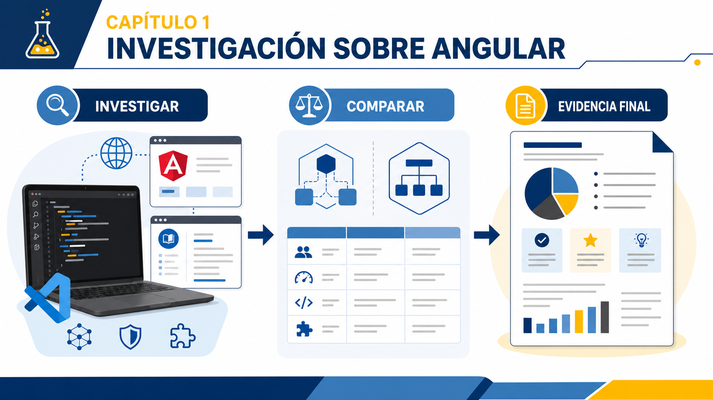
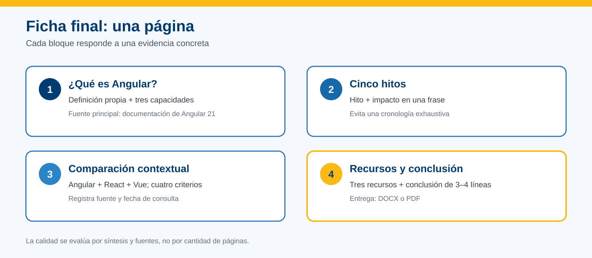
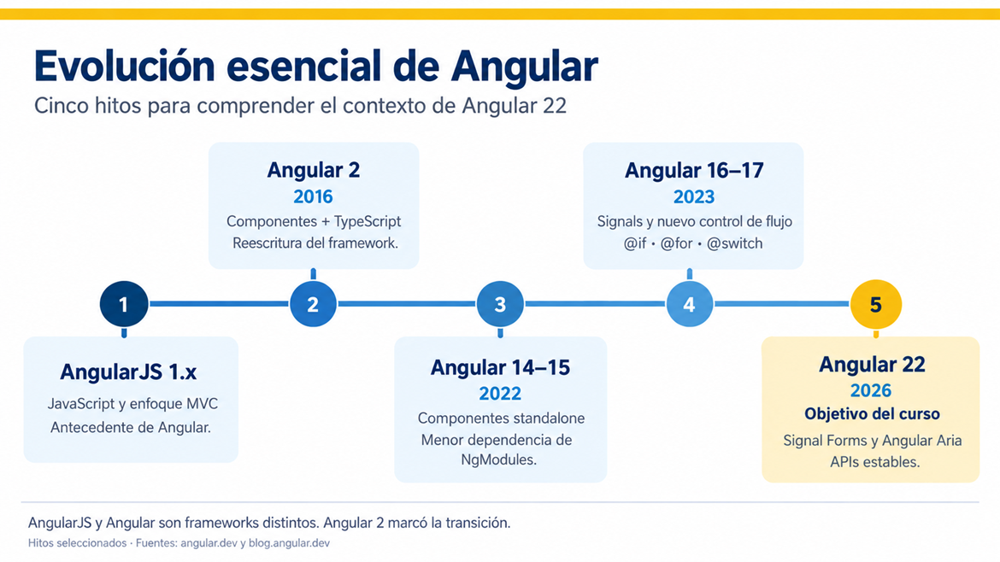

# Práctica 1.1 Investigación sobre Angular


## Objetivo

Investigar Angular mediante fuentes confiables para identificar sus capacidades principales, reconocer hitos de su evolución, compararlo de forma razonada con otras alternativas y seleccionar recursos útiles para el resto del curso.

Al finalizar, podrás explicar qué aporta Angular, relacionar tres de sus capacidades con ejemplos concretos y justificar una comparación sin depender únicamente de la popularidad de cada tecnología.


<br/>
<br/>

## Objetivo Visual




<br/>
<br/>

## Recursos

- Navegador web moderno: Chrome, Microsoft Edge o equivalente.
- Editor para completar la ficha: Word, Google Docs, VS Code o equivalente.
- [Descripción general de Angular](https://angular.dev/overview).
- [Anuncio oficial de Angular 22](https://angular.dev/events/v22).
- [Historial oficial de versiones de Angular](https://github.com/angular/angular/releases).
- [Política de versiones y soporte](https://angular.dev/reference/releases).
- [Documentación oficial de React](https://react.dev/).
- [Introducción oficial a Vue](https://vuejs.org/guide/introduction).

<br/>

> **Versión objetivo del curso: Angular 22.** La documentación principal de `angular.dev` cambia con las versiones. Antes de comenzar, verifica la versión indicada en el sitio. Si muestra una posterior, utiliza el selector de versiones para consultar Angular 22. Angular 21 se estudiará solamente como un hito anterior.

<br/>

## Entregable

Crea un documento llamado:

```text
Lab01_Investigacion_Angular_Apellido_Nombre.docx
```

También puedes entregarlo en PDF, conservando el mismo nombre base.

<br/>

**Extensión: dos páginas como máximo**, con texto legible. No es necesario reducirlo a una sola página.

Debe contener solamente estas cuatro secciones:

1. ¿Qué es Angular?
2. Seis hitos de evolución.
3. Comparación Angular, React y Vue.
4. Recursos seleccionados y conclusión.

Integra las fuentes en la sección correspondiente mediante enlaces o referencias breves. Registra una fecha general de consulta; si alguna fuente se consultó en otra fecha, indícala junto a ella.



<br/>
<br/>

### Paso 1. Identificar qué ofrece Angular


1. Abre la [descripción general de Angular](https://angular.dev/overview) y verifica que corresponda a Angular 22.
2. Localiza el título **What is Angular?**.
3. Lee la definición inicial y revisa las capacidades presentadas.
4. En la primera sección de tu ficha, escribe una definición de Angular con tus propias palabras, en dos o tres líneas.
5. Identifica tres capacidades y explica qué permite hacer cada una. Agrega un ejemplo de su aplicación en un portal de capacitación.
6. Explica en una o dos líneas por qué Angular puede ser apropiado para aplicaciones mantenidas por equipos. Relaciona tu explicación con una característica identificada.

<br/>

Puedes organizar las capacidades así:

| Capacidad | ¿Qué permite hacer? | Ejemplo en un portal de capacitación |
|---|---|---|
| Capacidad 1 | | |
| Capacidad 2 | | |
| Capacidad 3 | | |

Por ejemplo, si eliges formularios, podrías relacionarlos con la captura y validación de datos de una inscripción. Desarrolla tus propias explicaciones para las tres capacidades.

No copies párrafos completos ni te limites a enumerar nombres. En esta práctica reconocerás las capacidades; su implementación se abordará durante el curso.

<br/>

### Resultado esperado

Una definición propia, tres capacidades explicadas mediante ejemplos y una razón fundamentada relacionada con el trabajo en equipo.

<br/>

### Comprobación

- [ ] Verifiqué que la documentación utilizada corresponde a Angular 22.
- [ ] Puedo explicar por qué Angular es un framework y no solamente una biblioteca de interfaz.
- [ ] Cada capacidad tiene una explicación y un ejemplo.
- [ ] Registré la fuente consultada.

<br/>
<br/>

### Paso 2. Verificar y explicar seis hitos de evolución


Investiga los **seis hitos propuestos**. La siguiente tabla es una guía de búsqueda: tu trabajo consiste en verificar la información y explicar la importancia de cada cambio con tus propias palabras.

<br/>



| Hito | Aspecto que debes verificar |
|---|---|
| AngularJS 1.x | Su papel como antecedente y las diferencias de su arquitectura respecto de Angular moderno. |
| Angular 2 | La reescritura orientada a componentes y el uso de TypeScript. |
| Angular 14–15 | La introducción de las API standalone en Angular 14 y su estabilización en Angular 15. |
| Angular 16–17 | La introducción de Signals en Angular 16 y del nuevo control de flujo en templates en Angular 17. |
| Angular 21 | Un cambio concreto que ejemplifique la consolidación del enfoque moderno. Identifícalo en su anuncio oficial. |
| Angular 22 | Su papel como versión objetivo del curso y la estabilización de Signal Forms y Angular Aria. |

<br/>

Fuentes para orientar la búsqueda:

- **AngularJS:** [repositorio oficial de AngularJS](https://github.com/angular/angular.js). Es una fuente histórica distinta del repositorio de Angular moderno.
- **Angular moderno:** [historial oficial de versiones](https://github.com/angular/angular/releases) y [hoja de ruta, incluidos los cambios completados](https://angular.dev/roadmap). En releases, utiliza la búsqueda de versiones para localizar las antiguas.
- **Angular 16–17:** [hoja de ruta de la documentación de Angular 17](https://v17.angular.io/guide/roadmap).
- **Angular 21:** [anuncio oficial de Angular 21](https://angular.dev/events/v21), que enlaza a la publicación de lanzamiento.
- **Angular 22:** [anuncio oficial de Angular 22](https://angular.dev/events/v22).

<br/>

> **Distingue introducción de estabilización.** Una característica puede aparecer primero como experimental o como vista previa. Por ejemplo, el nuevo control de flujo se introdujo en Angular 17 como vista previa y se estabilizó en Angular 18. La agrupación de versiones no significa que todas las capacidades fueran estables desde su primera aparición.

Completa la segunda sección de tu ficha con frases breves:

| Hito | Cambio principal, con mis palabras | ¿Por qué fue importante? | Fuente |
|---|---|---|---|
| AngularJS 1.x | | | |
| Angular 2 | | | |
| Angular 14–15 | | | |
| Angular 16–17 | | | |
| Angular 21 | | | |
| Angular 22 | | | |

Puedes reutilizar una fuente cuando sustente varios hitos. No es necesario investigar todas las versiones ni aprender a programar las capacidades mencionadas.

<br/>

### Resultado esperado

Una tabla con seis hitos, el cambio principal y una explicación breve de su importancia, respaldados por fuentes identificables.

<br/>

### Comprobación

- [ ] Distingo AngularJS de Angular moderno.
- [ ] Expliqué los seis hitos propuestos.
- [ ] Distinguí la aparición de una característica de su estabilización cuando corresponde.
- [ ] Identifiqué Angular 22 como versión objetivo del curso.
- [ ] Evité convertir la actividad en una cronología de todas las versiones.

<br/>
<br/>

### Paso 3. Comparar Angular, React y Vue


Consulta primero las descripciones oficiales:

- [Angular](https://angular.dev/overview).
- [React](https://react.dev/).
- [Vue](https://vuejs.org/guide/introduction).

Considera que el alcance de las herramientas es diferente: Angular se presenta como un framework web; React, como una biblioteca para interfaces; y Vue, como un framework progresivo. Reconocer esta diferencia permite compararlas con mayor precisión.

Completa la siguiente tabla usando frases breves. No elijas un ganador universal: relaciona cada alternativa con un contexto y los conocimientos previos del equipo.

| Criterio | Angular | React | Vue |
|---|---|---|---|
| Alcance de la herramienta | | | |
| Convenciones y estructura | | | |
| Conocimientos y conceptos necesarios para comenzar | | | |
| Contexto en el que la considerarías | | | |

<br/>

Para orientar la investigación:

- **Alcance:** identifica qué proporciona la herramienta y qué puede requerir otras bibliotecas o herramientas del ecosistema.
- **Convenciones y estructura:** reconoce cómo propone organizar la interfaz y qué decisiones deja al equipo.
- **Conocimientos iniciales:** menciona lenguajes o conceptos necesarios. Evita reducirlo a etiquetas como «fácil» o «difícil».
- **Contexto:** plantea un caso y explica una razón para considerar esa alternativa. Tu propuesta no implica que sea la única opción válida.

Después de la tabla, responde en un máximo de tres líneas:

> Para un proyecto con varios equipos y mantenimiento de largo plazo, menciona dos factores que investigarías antes de elegir una tecnología. Explica por qué serían relevantes.

Registra las fuentes consultadas. Si utilizas una encuesta o una herramienta de tendencias como complemento, identifica qué mide y la fecha de los datos. La popularidad, las descargas o la satisfacción no demuestran por sí solas la adecuación técnica para un proyecto.

<br/>
 
### Resultado esperado

Una comparación cualitativa sustentada en documentación oficial, con una conclusión relacionada con el contexto del proyecto.

<br/>

### Comprobación

- [ ] Reconocí las diferencias de alcance entre Angular, React y Vue.
- [ ] Completé los cuatro criterios.
- [ ] Registré las fuentes y la fecha de consulta.
- [ ] Separé popularidad de adecuación técnica.
- [ ] Presenté dos factores razonados para la elección tecnológica.

<br/>
<br/>

### Paso 4. Seleccionar recursos y concluir


Revisa los siguientes recursos y selecciona los tres que utilizarías primero durante el curso:

| Recurso | Uso principal |
|---|---|
| [Documentación de Angular](https://angular.dev/overview) | Consultar conceptos y guías; verificar que la versión sea Angular 22. |
| [Repositorio de Angular](https://github.com/angular/angular) | Consultar código fuente, releases e incidencias. |
| [Blog oficial de Angular](https://blog.angular.dev) | Consultar anuncios y explicaciones del equipo. |
| [Referencia de Angular CLI](https://angular.dev/tools/cli) | Consultar herramientas y comandos; comprobar su correspondencia con la versión del curso. |
| [Preguntas sobre Angular en Stack Overflow](https://stackoverflow.com/questions/tagged/angular) | Investigar problemas concretos y contrastar las respuestas con documentación oficial. |

<br/>

En la cuarta sección de tu ficha:

1. Anota los tres recursos elegidos y sus enlaces.
2. Escribe una razón breve para cada elección. Señala qué tipo de duda resolverías con ese recurso.
3. Redacta una conclusión personal de tres o cuatro líneas que explique qué te parece más útil de Angular, qué tema esperas practicar y qué fuente consultarás primero cuando tengas una duda.

Para valorar una fuente, considera quién la publica, a qué versión se refiere y si su contenido sigue siendo aplicable. Una respuesta antigua puede servir como antecedente sin corresponder al funcionamiento actual.

<br/>

### Resultado esperado

Tres recursos priorizados según su utilidad y una conclusión breve relacionada con el curso.

<br/>

### Comprobación

- [ ] Seleccioné tres recursos con sus enlaces.
- [ ] Expliqué para qué utilizaría cada uno.
- [ ] Consideré la versión y la procedencia del contenido.
- [ ] Mi conclusión tiene entre tres y cuatro líneas.


<br/>
<br/>

### Paso 5. Contrastar hallazgos con un compañero


1. Intercambien sus fichas o expliquen sus hallazgos.
2. Revisen una capacidad de Angular, un hito y una conclusión de la comparación.
3. Identifiquen una afirmación que necesite precisión, una fuente adicional o una mejor explicación.
4. Consulten la fuente correspondiente y realicen el ajuste necesario.

Cada participante conserva su propio entregable. Si no encuentran un error, mejoren un ejemplo o su justificación. Integra los ajustes en las cuatro secciones existentes; no agregues una quinta sección.

<br/>

### Resultado esperado

Una ficha revisada mediante contraste de fuentes y explicaciones.

<br/>
<br/>

### Paso 6. Puesta en común y retroalimentación

El instructor solicitará intervenciones breves a algunos participantes para compartir:

- Una capacidad de Angular y su aplicación concreta.
- Una diferencia entre AngularJS y Angular moderno o entre dos hitos estudiados.
- Un factor que influya en la elección de una tecnología.

El grupo contrastará las respuestas con las fuentes. Utiliza la retroalimentación para realizar los últimos ajustes a tu ficha.

<br/>

### Resultado esperado

Explicaciones breves y fundamentadas, y aclaración de las principales dudas antes de entregar.

<br/>

## Validación final


Antes de entregar, verifica:

- [ ] La ficha tiene las cuatro secciones solicitadas.
- [ ] La definición está escrita con mis palabras.
- [ ] Incluí tres capacidades, cada una con una explicación y un ejemplo.
- [ ] Expliqué una razón relacionada con el trabajo en equipo.
- [ ] La cronología contiene los seis hitos propuestos y sus fuentes.
- [ ] Angular 22 aparece como versión objetivo del curso.
- [ ] La comparación utiliza cuatro criterios y considera el contexto.
- [ ] Respondí con dos factores para la elección tecnológica.
- [ ] Seleccioné tres recursos y justifiqué su utilidad.
- [ ] Incluí las fuentes y la fecha de consulta.
- [ ] La conclusión tiene entre tres y cuatro líneas.
- [ ] Integré los ajustes surgidos de la revisión y la retroalimentación.
- [ ] El documento tiene como máximo dos páginas y conserva texto legible.
- [ ] Guardé el archivo con el nombre indicado.

<br/>
<br/>

### Si un sitio no está disponible

Utiliza otra fuente oficial pertinente incluida en esta práctica y registra cuál no estuvo disponible. La fuente alternativa debe respaldar la afirmación que estás investigando.

Si no puedes verificar un dato, márcalo como **pendiente de verificación** y consúltalo con el instructor durante la puesta en común. No lo presentes como confirmado ni inviertas tiempo buscando capturas antiguas o datos sin procedencia.
