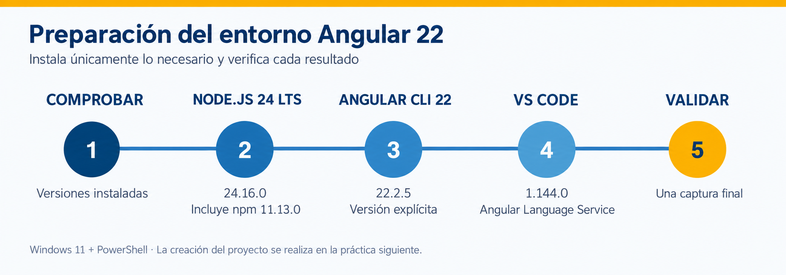

# Práctica 2.1 Instalación del software para el desarrollo con Angular

<br/>



<br/>

## Objetivo

Instalar o verificar las herramientas mínimas del curso: Node.js, npm, Angular CLI, Visual Studio Code y Angular Language Service.

<br/><br/>


## Instrucciones

### Paso 1. Comprobar el estado inicial


1. Abre **PowerShell**.
2. Ejecuta cada comando por separado:

```powershell
node --version
npm --version
ng version
code --version
```

3. Si una herramienta ya cumple la versión indicada, marca su instalación como completada y continúa con la siguiente.

4. Si PowerShell indica que un comando no se reconoce, realiza el paso correspondiente.

> Después de instalar una herramienta, cierra y vuelve a abrir PowerShell para actualizar el `PATH`.

<br/><br/>

### Paso 3. Instalar Node.js 22 LTS


1. Abre [nodejs.org/en/download](https://nodejs.org/en/download).
2. Selecciona una versión **22.x LTS** para Windows y descarga el instalador `.msi` apropiado para tu equipo.
3. Ejecuta el instalador.
4. Conserva la ruta predeterminada y asegúrate de que la opción para agregar Node.js al `PATH` permanezca habilitada.
5. Completa el asistente. No es necesario instalar herramientas adicionales para módulos nativos en esta práctica.
6. Cierra PowerShell, ábrelo nuevamente y ejecuta:

<br/>

```powershell
node --version
npm --version
```

**Resultado esperado:**

```text
v22.x.x
10.x.x
```

El número exacto de parche puede cambiar. npm se instala junto con Node.js.

<br/>
<br/>

### Paso 4. Instalar Angular CLI 

1. En PowerShell ejecuta:

```powershell
npm install --global @angular/cli@22
```

2. Verifica la instalación:

```powershell
ng version
```

3. Localiza estas líneas en la salida:

```text
Angular CLI: 22.x.x
Node: 22.x.x
Package Manager: npm 10.x.x
```

> Usa siempre la versión explícita `@angular/cli@22`. Así el entorno permanece alineado con la versión contractual del curso.


Si `ng` no se reconoce, cierra todas las ventanas de PowerShell y abre una nueva. Después repite `ng version`.

<br/>
<br/>

### Paso 5. Instalar y preparar Visual Studio Code

1. Descarga VS Code desde [code.visualstudio.com/download](https://code.visualstudio.com/download).
2. Ejecuta el instalador para Windows.
3. Durante la instalación, habilita **Agregar a PATH** y **Abrir con Code** cuando esas opciones estén disponibles.
4. Abre VS Code.
5. Presiona `Ctrl+Shift+X` para abrir **Extensiones**.
6. Busca **Angular Language Service**, publicado por **Angular**, e instálalo.
7. Cierra y abre de nuevo PowerShell; ejecuta:

```powershell
code --version
```

Angular Language Service proporciona asistencia para templates Angular. No es necesario instalar colecciones de snippets, temas, iconos ni extensiones de depuración del navegador para completar esta práctica.

<br/><br/>

### Paso 6. Verificar el entorno completo

Ejecuta los comandos siguientes y compara las líneas clave, no los números exactos de parche.


```powershell
node --version
npm --version
ng version
code --version
```

Comprueba:

- [ ] `node --version` comienza con `v22.`.
- [ ] `npm --version` muestra una versión disponible.
- [ ] `ng version` muestra Angular CLI `22.x` y no presenta errores de compatibilidad.
- [ ] `code --version` devuelve una versión.
- [ ] Angular Language Service aparece como instalada en VS Code.


<br/><br/>

## Validación

1. Ajusta el tamaño de PowerShell para que las cuatro verificaciones sean legibles.
2. Oculta nombres de usuario, rutas personales o información sensible si aparecen.
 

<br/><br/>

## Solución de problemas

| Situación | Acción |
| --- | --- |
| Un comando no se reconoce después de instalar | Cierra todas las terminales y abre PowerShell de nuevo. |
| `ng version` reporta otra versión mayor | Ejecuta `npm install --global @angular/cli@22` y vuelve a verificar. |
| El instalador solicita permisos | Solicita apoyo al instructor; no cambies políticas del equipo. |
| La descarga es lenta | Continúa con una instalación previamente descargada por el instructor. |
| `code` no se reconoce | Verifica VS Code desde el menú Inicio; el instructor puede corregir el `PATH`. |


<br/><br/>

## Bibliografía adicional

- https://angular.dev/reference/versions — Tabla oficial para comprobar la compatibilidad de Angular 22 con Node.js, TypeScript y RxJS. 

- https://nodejs.org/en/about/previous-releases — Historial de versiones de Node.js y sus etapas de soporte; permite identificar la rama 22 LTS. 

- https://angular.dev/tools/cli/setup-local — Guía oficial de preparación del entorno local, requisitos e instalación de Angular CLI. Para este curso, utiliza explícitamente @angular/cli@22. 

- https://docs.npmjs.com/cli/v11/commands/npm-install/ — Referencia de npm install: explica la instalación de paquetes, versiones específicas y la opción global --global. 

- https://code.visualstudio.com/docs/setup/windows — Instrucciones para instalar VS Code en Windows, configurar su acceso desde la terminal y resolver problemas habituales de instalación. 

- https://marketplace.visualstudio.com/items?itemName=Angular.ng-template — Página de la extensión oficial Angular Language Service; permite identificarla e instalarla en VS Code. 

- https://angular.dev/tools/language-service — Explica las funciones de Angular Language Service: autocompletado, diagnóstico de errores y navegación por las plantillas. 