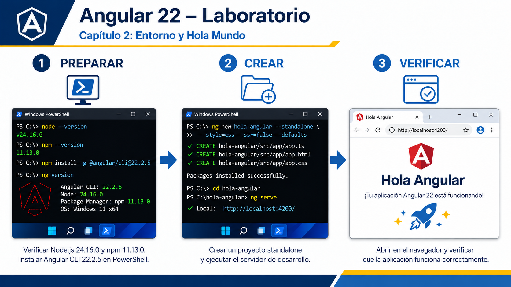
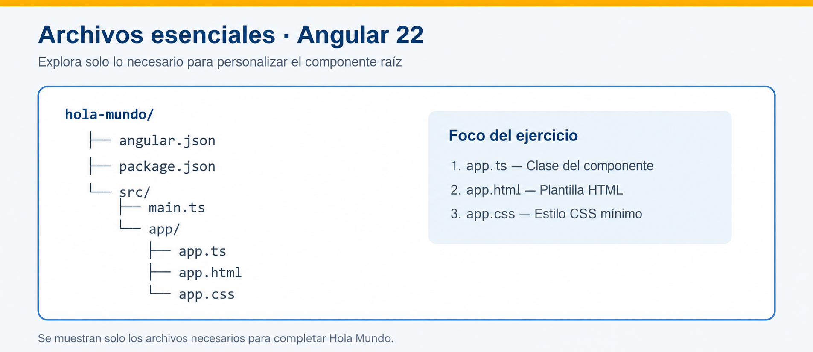

# Práctica 2.2 Crea el proyecto Hola Mundo de Angular y verifica que funcione correctamente

<br/>



<br/>
<br/>

## Objetivo

Crear un proyecto Angular con Angular CLI, reconocer sus archivos esenciales, ejecutar el servidor de desarrollo y personalizar el componente raíz para mostrar un mensaje en el navegador.

<br/>
<br/>

## Prerrequisitos

- Haber completado la práctica de instalación.
- `node --version` comienza con `v22.`.
- `ng version` muestra Angular CLI `22.x`.
- Visual Studio Code está disponible.

<br/>
<br/>

## Instrucciones

### Paso 1. Preparar el directorio de trabajo


Abre PowerShell y ejecuta:

```powershell
Set-Location $env:USERPROFILE
New-Item -ItemType Directory -Path angular-labs -Force
Set-Location angular-labs
```

<br/>

Comprueba la ubicación:

```powershell
Get-Location
```

La ruta debe terminar en `angular-labs`.

<br/>
<br/>

### Paso 2. Crear el proyecto Angular

Ejecuta el comando en una sola línea:

```powershell
ng new hola-mundo --routing=false --style=css --standalone --skip-git --skip-tests --file-name-style-guide=2016 --ssr=false --ai-config=none
```

Si ademas necesitas desactivar las preguntas interactivas, agrega --interactive=false

```powershell
ng new hola-mundo --routing=false --style=css --standalone --skip-git --skip-tests --file-name-style-guide=2016 --ssr=false --ai-config=none --interactive=false
```

<br/>

Las opciones mantienen el ejercicio enfocado:

| Comando u opción | Función | Resultado en el proyecto |
|---|---|---|
| `ng new hola-mundo` | Crea un espacio de trabajo con una aplicación Angular inicial. | Genera la carpeta `hola-mundo`, sus archivos de configuración y el código inicial; instala las dependencias. |
| `--routing=false` | Desactiva la configuración inicial de enrutamiento. | No configura rutas ni genera `app.routes.ts`. |
| `--style=css` | Selecciona CSS para los estilos de los componentes. | Genera archivos de estilos con extensión `.css`. |
| `--standalone` | Crea la aplicación con componentes standalone. Equivale a `--standalone=true`. | El componente raíz no necesita declararse en un `NgModule`; no se genera `app.module.ts`. |
| `--skip-git` | Omite la inicialización de un repositorio Git. | No crea la carpeta `.git` ni el commit inicial. Puede generar `.gitignore`. |
| `--skip-tests` | Omite la generación de archivos de pruebas unitarias. | No genera archivos como `app.component.spec.ts`. Puede conservar configuración y dependencias para pruebas. |
| `--file-name-style-guide=2016` | Utiliza nombres que incluyen el tipo de elemento. | Genera `app.component.ts`, `app.component.html` y `app.component.css`, en lugar de `app.ts`, `app.html` y `app.css`. |
| `--ssr=false` | Desactiva la configuración inicial de SSR y SSG/prerenderizado. | Crea la aplicación sin preparar renderizado en servidor ni prerenderizado. |
| `--ai-config=none` | Omite la configuración de integración con herramientas de IA. | No genera archivos de instrucciones específicos para esas herramientas. |
| `--interactive=false` | Desactiva las preguntas interactivas de configuración. | Ejecuta la creación con las opciones proporcionadas y los valores predeterminados aplicables. |

<br/>

Estas opciones están documentadas en la referencia oficial de ng new. angular.dev

Importante: --file-name-style-guide=2016 modifica los nombres de los archivos; la aplicación sigue siendo Angular 22.

<br/>

Cuando finalice, confirma que existe la carpeta:

```powershell
Test-Path .\hola-mundo
```

**Resultado esperado:** `True`.

<br/>
<br/>

### Paso 3. Reconocer la estructura mínima

1. Entra al proyecto y ábrelo en VS Code:

```powershell
Set-Location .\hola-mundo
code .
```

2. Localiza únicamente estos archivos:



| Archivo | Responsabilidad |
|---|---|
| `app.component.ts` | Define los datos y el comportamiento del componente raíz. |
| `app.component.html` | Define su interfaz visual. |
| `app.component.css` | Define sus estilos. |
| **`app.config.ts`** | Configura servicios y funcionalidades disponibles en la aplicación. |

<br/>

```typescript
// app.config.ts

import { ApplicationConfig } from '@angular/core';

// Configuración que se utilizará al iniciar la aplicación.
export const appConfig: ApplicationConfig = {
  providers: [
    // Aquí se registran proveedores de servicios
    // y configuraciones generales de Angular.
  ]
};
```


<br/>

No es necesario revisar el contenido completo de `angular.json`, `tsconfig.json` ni `package-lock.json`.


<br/>
<br/>

### Paso 4. Ejecutar la aplicación inicial

En PowerShell, dentro de `hola-mundo`, ejecuta:

```powershell
ng serve --open
```

Espera hasta observar un mensaje de compilación completada. El navegador debe abrir:

```text
http://localhost:4200
```

Mantén esta terminal abierta. Para detener el servidor al finalizar utiliza `Ctrl+C`.

> Si el puerto 4200 está ocupado, ejecuta `ng serve --open --port 4201` 

<br/><br/>

## Bibliografía adicional

- [https://angular.dev/reference/configs/file-structure](https://angular.dev/reference/configs/file-structure) — **Lectura inicial recomendada.** Describe las carpetas y archivos del proyecto: `src/`, `public/`, `main.ts`, `app.config.ts`, `angular.json` y los archivos del componente raíz. [Angular](https://angular.dev/reference/configs/file-structure)

- [https://angular.dev/guide/components](https://angular.dev/guide/components) — Explica cómo se relacionan la clase TypeScript, la plantilla HTML y los estilos CSS de un componente. [Angular](https://angular.dev/guide/components)

- [https://angular.dev/api/core/ApplicationConfig](https://angular.dev/api/core/ApplicationConfig) — Referencia para comprender el objeto exportado desde `app.config.ts` y su propiedad `providers`. [Angular](https://angular.dev/api/core/ApplicationConfig)

- [https://angular.dev/api/platform-browser/bootstrapApplication](https://angular.dev/api/platform-browser/bootstrapApplication) — Explica cómo `main.ts` inicia una aplicación standalone utilizando el componente raíz y la configuración de la aplicación. [Angular](https://angular.dev/api/platform-browser/bootstrapApplication)

- [https://angular.dev/reference/configs/workspace-config](https://angular.dev/reference/configs/workspace-config) — Describe `angular.json`: configuración de compilación, servidor de desarrollo, pruebas, estilos y recursos estáticos. [Angular](https://angular.dev/reference/configs/workspace-config)

- [https://angular.dev/reference/configs/npm-packages](https://angular.dev/reference/configs/npm-packages) — Explica la función de `package.json` y los principales paquetes que utiliza un proyecto Angular. [Angular](https://angular.dev/reference/configs/npm-packages)

- [https://angular.dev/reference/configs/angular-compiler-options](https://angular.dev/reference/configs/angular-compiler-options) — Ayuda a comprender las opciones de Angular dentro de `tsconfig.json`, incluida la comprobación estricta de las plantillas. [Angular](https://angular.dev/reference/configs/angular-compiler-options)