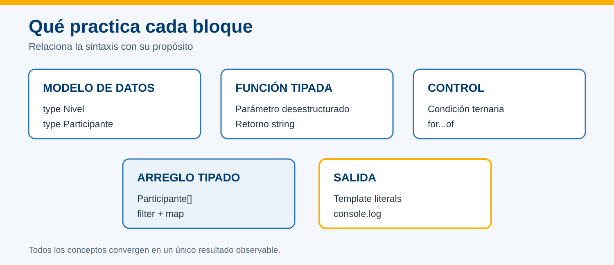

# Práctica 3.1 Programación con TypeScript


<br/>
<br/>

## Objetivo

Construir un programa breve que aplique tipos, funciones, control de flujo, arreglos, métodos funcionales y desestructuración; después compilarlo a JavaScript y ejecutarlo con Node.js.

<br/>
<br/>

## Prerrequisitos

- Proyecto `hola-mundo` creado en la práctica anterior.
- Node.js 22 disponible.
- Dependencias del proyecto instaladas.
- Visual Studio Code disponible.


<br/>
<br/>

## Instrucciones

### Paso 1. Preparar el ejercicio

Abre PowerShell y entra al proyecto de la práctica anterior:

```powershell
Set-Location "$env:USERPROFILE\angular-labs\hola-mundo"
New-Item -ItemType Directory -Path practica-ts -Force
code .
```

En VS Code crea:

```text
practica-ts/fundamentos.ts
practica-ts/tsconfig.json
```

<br/>

En `practica-ts/tsconfig.json`, copia esta configuración para el ejercicio:

```json
{
  "compilerOptions": {
    "target": "ES2022",
    "module": "NodeNext",
    "strict": true,
    "noEmitOnError": true,
    "types": [],
    "outDir": "./dist"
  },
  "files": [
    "fundamentos.ts"
  ]
}
```

<br/>

Esta configuración se utiliza únicamente para el ejercicio y no modifica el `tsconfig.json` de Angular. `noEmitOnError` impide generar una nueva salida JavaScript si hay errores de tipos.

> El ejercicio usa `npx.cmd --no-install tsc`, que ejecuta la versión de TypeScript instalada dentro del proyecto sin descargar otro paquete. No requiere una instalación global adicional. En PowerShell, `npx.cmd` evita depender de la política de ejecución de `npx.ps1`.

<br/><br/>

### Paso 2. Escribir un programa tipado

Copia este contenido en `practica-ts/fundamentos.ts`:

```typescript
type Nivel = 'inicial' | 'intermedio';

type Participante = {
  nombre: string;
  edad: number;
  activo: boolean;
  nivel: Nivel;
};

const participantes: Participante[] = [
  { nombre: 'Ana', edad: 28, activo: true, nivel: 'inicial' },
  { nombre: 'Luis', edad: 34, activo: false, nivel: 'intermedio' },
  { nombre: 'Marta', edad: 31, activo: true, nivel: 'intermedio' },
];

function describir({ nombre, edad, nivel }: Participante): string {
  const categoria = edad >= 30 ? '30 años o más' : 'menor de 30';
  return `${nombre} | ${nivel} | ${categoria}`;
}

const resumen: string[] = participantes
  .filter((participante) => participante.activo)
  .map(describir);

for (const linea of resumen) {
  console.log(linea);
}

console.log(`Total activo: ${resumen.length}`);
```

<br/>

Antes de continuar, identifica en el código:

- el tipo unión `Nivel`;
- el tipo de objeto `Participante`;
- el arreglo tipado;
- los parámetros y retorno de `describir`;
- la condición ternaria;
- `filter`, `map`, `for...of` y la desestructuración.



<br/><br/>

### Paso 3. Compilar y ejecutar

Desde la raíz de `hola-mundo`, ejecuta:

```powershell
npx.cmd --no-install tsc --project .\practica-ts
if ($LASTEXITCODE -eq 0) {
    node .\practica-ts\dist\fundamentos.js
}
```

**Salida esperada:**

```text
Ana | inicial | menor de 30
Marta | intermedio | 30 años o más
Total activo: 2
```

Si el compilador termina sin mensajes y con código de salida `0`, la compilación finalizó sin errores. El bloque ejecuta Node.js únicamente cuando la compilación fue exitosa.

<br/><br/>

### Paso 4. Comprobar el tipado

1. Cambia temporalmente la edad de Ana por un texto:

```typescript
{ nombre: 'Ana', edad: 'veintiocho', activo: true, nivel: 'inicial' },
```

2. Guarda el archivo y compila nuevamente:

```powershell
npx.cmd --no-install tsc --project .\practica-ts
```

3. Observa que TypeScript informa que `string` no puede asignarse a `number`.
4. Restablece `edad: 28`, guarda y vuelve a compilar y ejecutar con el bloque del paso 3.

Este error intencional no debe permanecer en la entrega.

> Si la compilación falla, no ejecutes Node.js. Puede existir un `fundamentos.js` de una compilación anterior; `noEmitOnError` no elimina ese archivo.

<br/><br/>

### Paso 5. Validar y entregar

- [ ] `fundamentos.ts` conserva los tipos de `Nivel`, `Participante`, el arreglo y la función; las demás expresiones pueden utilizar inferencia.
- [ ] La última compilación finaliza sin errores.
- [ ] Existe `practica-ts/dist/fundamentos.js`.
- [ ] La salida contiene solo Ana, Marta y el total `2`.
- [ ] La captura muestra el comando y la salida legible.


<br/>

## Solución de problemas

| Situación | Acción |
| --- | --- |
| No existe la carpeta `hola-mundo` | Confirma la ruta creada en la práctica anterior. |
| `npx` solicita instalar otro paquete o no encuentra TypeScript | Cancela y confirma que ejecutas el comando dentro de `hola-mundo` y que sus dependencias están instaladas. |
| No se encuentra la configuración del ejercicio | Confirma que existe `practica-ts/tsconfig.json` y que utilizas `--project .\practica-ts`. |
| La compilación muestra el error intencional | Restablece `edad: 28` y guarda el archivo. |
| Node no encuentra el JavaScript | Verifica que la compilación creó `practica-ts/dist/fundamentos.js`. |

<br/><br/>

## Aprendizajes esperados

| Concepto | Aplicación en la práctica | Aprendizaje esperado |
|---|---|---|
| Compilación | `tsconfig.json` y `tsc --project`. | Compilar TypeScript a JavaScript utilizando la configuración del ejercicio. |
| Ejecución | `node fundamentos.js`, desde su ruta de salida. | Distinguir la compilación de la ejecución y comprobar los resultados. |
| Variables y tipos básicos | `const`, `string`, `number` y `boolean`. | Declarar datos con tipos adecuados y reconocer la inferencia de tipos. |
| Unión de literales | `type Nivel`. | Restringir los valores permitidos a `'inicial'` e `'intermedio'`. |
| Tipos de objeto | `type Participante`. | Definir las propiedades y tipos que deben cumplir los objetos. |
| Arreglos tipados | `Participante[]`, `string[]` y `length`. | Agrupar elementos del mismo tipo y consultar su cantidad. |
| Funciones tipadas | `describir(...): string`. | Definir el tipo del parámetro y del valor de retorno. |
| Funciones flecha | `(participante) => participante.activo`. | Expresar una función breve utilizada como criterio de selección. |
| Métodos funcionales | `filter` y `map`. | Seleccionar participantes activos y transformar sus datos en descripciones. |
| Asignación, comparación y condición ternaria | `=`, `>=` y `condición ? valor1 : valor2`. | Asignar valores y elegir un resultado según una condición. |
| Recorrido de arreglos | `for...of`. | Recorrer los valores de un arreglo y mostrar cada resultado. |
| Cadenas e interpolación | Plantillas con `${...}`. | Construir mensajes que combinen texto y valores. |
| Desestructuración | `{ nombre, edad, nivel }`. | Extraer propiedades de un objeto en los parámetros de una función. |
| Comprobación de tipos | Asignar temporalmente `'veintiocho'` a `edad`. | Identificar un error de tipos, corregirlo y volver a compilar. |


<br/><br/>

## Bibliografía adicional

Para agregar al final de la **práctica 3.1**, estas referencias se relacionan directamente con el ejercicio:

**1. TypeScript Playground — practicar en línea**  
[https://www.typescriptlang.org/play/](https://www.typescriptlang.org/play/)  
Editor oficial para escribir TypeScript, observar el JavaScript generado, detectar errores y ejecutar ejemplos desde el navegador. Puedes pegar el programa de participantes y experimentar con sus tipos. [typescriptlang.org](https://www.typescriptlang.org/play/?utm_source=chatgpt.com)

**2. Fundamentos de TypeScript**  
[https://www.typescriptlang.org/docs/handbook/2/basic-types.html](https://www.typescriptlang.org/docs/handbook/2/basic-types.html)  
Explica la comprobación de tipos, el compilador `tsc`, la generación de JavaScript y el comportamiento de `noEmitOnError`. [The Basics](https://www.typescriptlang.org/docs/handbook/2/basic-types.html?utm_source=chatgpt.com)

**3. Tipos de uso cotidiano**  
[https://www.typescriptlang.org/docs/handbook/2/everyday-types.html](https://www.typescriptlang.org/docs/handbook/2/everyday-types.html)  
Referencia para tipos básicos, arreglos, objetos, funciones, uniones y alias de tipos. Ayuda a comprender `Nivel`, `Participante` y `Participante[]`. [Everyday Types](https://www.typescriptlang.org/docs/handbook/2/everyday-types.html?utm_source=chatgpt.com)

**4. Funciones y desestructuración de parámetros**  
[https://www.typescriptlang.org/docs/handbook/2/functions.html](https://www.typescriptlang.org/docs/handbook/2/functions.html)  
Profundiza en las funciones y contiene una sección sobre desestructuración de parámetros, como la utilizada en `describir`. [More on Functions](https://www.typescriptlang.org/docs/handbook/2/functions.html?utm_source=chatgpt.com)

**5. Referencia de configuración: TSConfig**  
[https://www.typescriptlang.org/tsconfig/](https://www.typescriptlang.org/tsconfig/)  
Documenta las opciones del archivo `tsconfig.json`, incluidas `strict`, `target`, `outDir` y `noEmitOnError`. [Docs on every TSConfig option](https://www.typescriptlang.org/tsconfig/?utm_source=chatgpt.com)

**6. Arreglos de JavaScript — MDN, en español**  
[https://developer.mozilla.org/es/docs/Web/JavaScript/Reference/Global_Objects/Array](https://developer.mozilla.org/es/docs/Web/JavaScript/Reference/Global_Objects/Array)  
Explica los arreglos y sus métodos. Para esta práctica, conviene consultar especialmente `filter`, que selecciona elementos, y `map`, que transforma sus valores. [MDN](https://developer.mozilla.org/es/docs/Web/JavaScript/Reference/Global_Objects/Array?utm_source=chatgpt.com)

