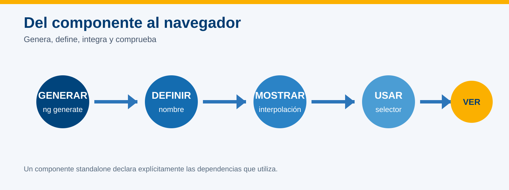
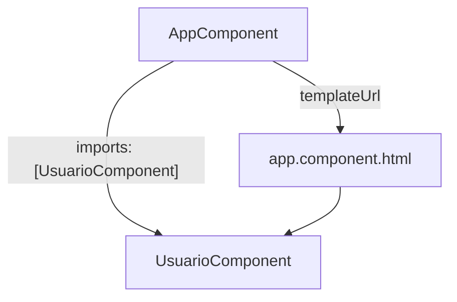

# Práctica 4.1 Crear un componente simple que muestre el nombre de un usuario

<br/>
<br/>

## Objetivo

Generar un componente standalone, definir una propiedad `nombre`, mostrarla mediante interpolación e integrar el componente en la vista raíz de la aplicación.


<br/>



<br/>


## Contexto

Agregarás una tarjeta de perfil a la aplicación `hola-mundo`. El componente raíz mostrará el encabezado de la aplicación y utilizará un nuevo componente llamado `UsuarioComponent` para presentar tu nombre.

Al terminar, reconocerás cómo colaboran la clase TypeScript, la plantilla HTML y los estilos CSS de un componente.

<br/>
<br/>

## Prerrequisitos

- Proyecto `hola-mundo` creado en las prácticas del capítulo 2, con Angular 22, componentes standalone, CSS y la convención de nombres 2016 (`--file-name-style-guide=2016`).
- Dependencias del proyecto instaladas y Angular CLI 22 disponible.
- Visual Studio Code disponible.
- Conocimientos básicos de clase, propiedad y plantilla HTML.

> Esta práctica continúa el proyecto existente. No es necesario crear una aplicación nueva.

<br/>
<br/>

## Instrucciones

### Paso 1. Abrir y verificar el proyecto

Abre PowerShell y entra en la carpeta del proyecto. El siguiente comando utiliza la ubicación propuesta en las prácticas anteriores; ajústala si guardaste el proyecto en otra carpeta:

```powershell
Set-Location "$env:USERPROFILE\angular-labs\hola-mundo"
code .
```

Confirma que estás en la carpeta correcta:

```powershell
Test-Path .\angular.json
Test-Path .\src\app\app.component.ts
ng version
```

**Resultado esperado:** las dos comprobaciones muestran `True` y `ng version` informa las versiones de Angular y Angular CLI correspondientes al entorno 22 del curso.

> Si existe `app.ts` en lugar de `app.component.ts`, el proyecto utiliza otra convención de nombres y no necesariamente está mal. Consulta la práctica de creación del proyecto, en el capítulo 2, y confirma con el instructor la correspondencia de archivos y clases antes de continuar. No recrees el proyecto ni renombres archivos de forma aislada.

Si todavía tienes `ng serve` ejecutándose de una práctica anterior, detenlo con `Ctrl+C` en su terminal. En el paso 6 volverás a iniciarlo.

<br/>
<br/>

### Paso 2. Generar el componente

Desde la raíz de `hola-mundo`, ejecuta:

```powershell
ng generate component usuario --standalone --skip-tests --type=component
```

Las opciones utilizadas indican lo siguiente:

| Opción | Propósito |
| --- | --- |
| `--standalone` | Generar un componente que no necesita declararse en un `NgModule`. |
| `--skip-tests` | Omitir el archivo de pruebas unitarias para esta práctica introductoria. |
| `--type=component` | Agregar `.component` al nombre de los archivos. |

<br/>

Angular CLI debe crear estos archivos:

| Archivo | Responsabilidad |
| --- | --- |
| `src/app/usuario/usuario.component.ts` | Definir la clase y la configuración del componente. |
| `src/app/usuario/usuario.component.html` | Definir la estructura de la tarjeta. |
| `src/app/usuario/usuario.component.css` | Definir su apariencia. |

Abre los tres archivos e identifica cuál corresponde a los datos, cuál a la estructura y cuál a los estilos.

> En Angular 22 los componentes son standalone por defecto. La opción se incluye en el comando para expresar el propósito del ejercicio; no necesitas agregar `standalone: true` al decorador.

<br/>
<br/>

### Paso 3. Definir el nombre del usuario

Reemplaza el contenido de `src/app/usuario/usuario.component.ts` por:

```typescript
import { Component } from '@angular/core';

@Component({
  selector: 'app-usuario',
  imports: [],
  templateUrl: './usuario.component.html',
  styleUrl: './usuario.component.css',
})
export class UsuarioComponent {
  readonly nombre = 'Escribe aquí tu nombre';
}
```

Sustituye `'Escribe aquí tu nombre'` por tu nombre, conservando las comillas, y guarda el archivo.

La propiedad `nombre` pertenece a cada instancia del componente. TypeScript infiere su tipo a partir del valor inicial.

`readonly` impide reasignar la propiedad desde el código TypeScript después de su inicialización. Puedes editar el texto de su declaración y guardar el archivo para personalizar el ejemplo; eso es modificar el código fuente, no reasignar la propiedad durante la ejecución.

<br/>

Identifica también estos elementos de `@Component`:

| Elemento | Significado en esta práctica |
| --- | --- |
| `selector` | Nombre del elemento que utilizarás en la plantilla raíz: `<app-usuario>`. |
| `imports` | Dependencias que puede utilizar la plantilla. Está vacío porque aquí basta con HTML e interpolación. |
| `templateUrl` | Ruta de la plantilla HTML del componente. |
| `styleUrl` | Ruta de la hoja de estilos del componente. |


<br/>
<br/>

### Paso 4. Mostrar la propiedad en la plantilla

Reemplaza el contenido de `src/app/usuario/usuario.component.html` por:

```html
<section class="usuario">
  <h2>Perfil de usuario</h2>
  <p>Nombre: <strong>{{ nombre }}</strong></p>
</section>
```

`{{ nombre }}` es interpolación: Angular evalúa la expresión en el contexto del componente y presenta su valor como texto en la página.

<br/>

Reemplaza el contenido de `src/app/usuario/usuario.component.css` por:

```css
.usuario {
  max-width: 520px;
  margin: 2rem auto;
  padding: 1.5rem;
  border-left: 8px solid #fbb000;
  box-shadow: 0 4px 16px #0002;
}

h2 {
  margin-top: 0;
  color: #003b71;
}
```

Guarda ambos archivos.

**Antes de ejecutar, anticipa el resultado:** ¿el navegador mostrará las llaves de `{{ nombre }}` o el texto que escribiste en la propiedad?

<br/>
<br/>

### Paso 5. Integrar el componente en `AppComponent`

#### 5.1 Importar la clase y registrar la dependencia

Reemplaza el contenido de `src/app/app.component.ts` por:

```typescript
import { Component } from '@angular/core';
import { UsuarioComponent } from './usuario/usuario.component';

@Component({
  selector: 'app-root',
  imports: [UsuarioComponent],
  templateUrl: './app.component.html',
  styleUrl: './app.component.css',
})
export class AppComponent {}
```

La sentencia `import` permite utilizar la clase en este archivo TypeScript. El arreglo `imports` del decorador permite utilizar el componente en la plantilla de `AppComponent`.

<br/>

#### 5.2 Usar el selector

Reemplaza el contenido de `src/app/app.component.html` por:

```html
<main>
  <h1>Mi primera aplicación Angular</h1>
  <app-usuario></app-usuario>
</main>
```

La integración requiere tres acciones:

1. Importar la clase `UsuarioComponent` mediante una sentencia `import`.
2. Agregar `UsuarioComponent` al arreglo `imports` de `@Component`.
3. Utilizar su selector `<app-usuario>` en la plantilla raíz.

La relación entre los componentes queda así:



<br/>

#### 5.3 Comprobar el arranque de la aplicación

Abre `src/main.ts` y verifica que la clase importada y la utilizada en `bootstrapApplication` sea `AppComponent`:

```typescript
import { AppComponent } from './app/app.component';
```

La llamada de arranque debe utilizar:

```typescript
bootstrapApplication(AppComponent, appConfig)
```

Estos fragmentos son una comprobación: conserva los demás imports, la configuración `appConfig` y el manejo de errores que ya tenga `main.ts`.

> Esta práctica reemplaza la personalización anterior del componente raíz por un encabezado y una tarjeta. No requiere modificar `app.config.ts` ni crear un módulo raíz.

<br/>
<br/>

### Paso 6. Ejecutar y comprobar

Ejecuta desde la raíz del proyecto:

```powershell
ng serve --open
```

Espera a que termine la compilación y verifica la aplicación en [http://localhost:4200](http://localhost:4200).

El navegador debe mostrar:

- El encabezado **Mi primera aplicación Angular**.
- Una tarjeta con el título **Perfil de usuario**.
- El texto **Nombre:** seguido del nombre que escribiste en la clase.
- El borde y la sombra definidos en el CSS.

<br/>
<br/>

### Experimenta y observa

Con el servidor activo, realiza estas comprobaciones breves:

1. **Datos:** cambia el texto inicial de `nombre` en `usuario.component.ts`, guarda y comprueba que la página muestra el nuevo texto. 

2. **Apariencia:** cambia el color del borde de la tarjeta, por ejemplo a `#7aa6c2`, guarda y observa el resultado.

3. **Reutilización:** agrega temporalmente un segundo `<app-usuario></app-usuario>` en `app.component.html`. Comprueba que aparecen dos tarjetas y después retira la segunda.

> Cada uso del selector crea una instancia del componente. Las dos tarjetas muestran el mismo nombre porque ambas instancias comienzan con el mismo valor definido en la clase.

La actualización que observas al guardar corresponde a la recompilación o recarga del entorno de desarrollo. En esta práctica no se modifica `nombre` mediante una interacción de la aplicación.

<br/>
<br/>

### Lista de comprobación

- [ ] La terminal no muestra errores de compilación.
- [ ] Aparece **Mi primera aplicación Angular**.
- [ ] La tarjeta muestra **Perfil de usuario**.
- [ ] Tu nombre aparece dentro de la tarjeta.
- [ ] No se muestra literalmente `{{ nombre }}`.
- [ ] Se aplican los estilos del componente.
- [ ] Dejaste una sola tarjeta para la parte final.

<br/>
<br/>

### Paso 7. Explicar el resultado

1. Mantén visible la dirección `localhost:4200`, o el puerto alternativo que hayas utilizado.

2. Antes de terminar, responde oralmente o en tus notas:
   - ¿Qué archivo define el dato `nombre`?
   - ¿Qué archivo define la estructura de la tarjeta y cuál su apariencia?
   - ¿Qué diferencia hay entre la sentencia `import` y el arreglo `imports` del decorador?

3. Detén el servidor con `Ctrl+C` cuando termines.

**Criterio de logro:** puedes mostrar tu nombre mediante interpolación y explicar cómo se integra `UsuarioComponent` en la plantilla de `AppComponent`.

<br/>
<br/>

## Solución de problemas

| Situación | Acción |
| --- | --- |
| `app-usuario is not a known element` | Confirma la sentencia `import`, la ruta de la clase, `imports: [UsuarioComponent]` y la escritura del selector. |
| No aparece el nombre | Verifica que la propiedad se llame `nombre`, que la plantilla use `{{ nombre }}` y que hayas guardado los archivos. Revisa los errores de compilación. |
| Se muestra literalmente `{{ nombre }}` | Accede a la aplicación mediante la URL de `ng serve`; no abras `usuario.component.html` directamente como archivo. |
| No existen archivos `.component.*` | Confirma la convención de nombres del proyecto y el uso de `--type=component` al generar el componente. No renombres archivos sin actualizar sus referencias. |
| `No matching export` para `App` | Revisa `src/main.ts`: debe importar `AppComponent` desde `./app/app.component` y utilizar esa misma clase en `bootstrapApplication`. |
| Angular CLI indica que estás fuera de un workspace | Entra en la carpeta `hola-mundo` que contiene `angular.json`. |
| El componente `usuario` ya existe | Revisa sus archivos y continúa con su edición; no vuelvas a generarlo ni utilices `--force`. |
| Puerto 4200 ocupado | Ejecuta `ng serve --open --port 4201` y utiliza `http://localhost:4201` para la comprobación. |
| No se aplican los estilos | Revisa `styleUrl`, el nombre del archivo CSS y la clase `usuario` en el elemento `<section>`. |

<br/>
<br/>

## Conceptos practicados

| Concepto | Aplicación en el laboratorio |
| --- | --- |
| Angular CLI | Generación del componente. |
| Componente standalone | Uso de `UsuarioComponent` sin declararlo en un `NgModule`. |
| Clase y propiedad | Definición de `UsuarioComponent` y `nombre`. |
| Interpolación | Presentación de `nombre` mediante `{{ nombre }}`. |
| Plantilla HTML | Estructura del perfil de usuario. |
| Estilos CSS | Apariencia de la tarjeta. |
| Composición | Integración del componente de usuario en la vista raíz. |
| Reutilización | Uso temporal del mismo selector en dos lugares de la plantilla. |

<br/>
<br/>

## Referencias

- [Componentes de Angular](https://angular.dev/essentials/components): creación, composición e integración de componentes.

- [Generación de componentes con Angular CLI](https://angular.dev/cli/generate/component): opciones del comando utilizado.

- [Interpolación y enlaces en plantillas](https://angular.dev/guide/templates/binding): presentación de valores del componente en la vista.


