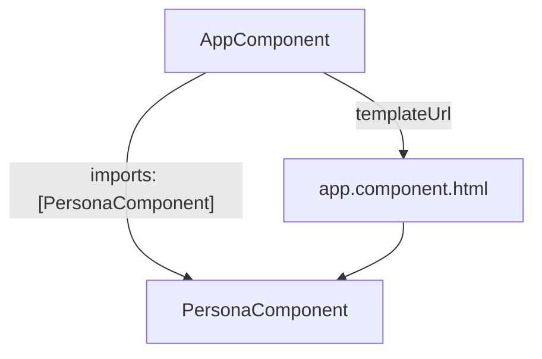

# Práctica 4.2 Crear un componente que muestre los datos de una persona en una página web como son nombre, domicilio, teléfono y correo electrónico
<!--  -->

<br/>
<br/>

## Objetivo

Crear un proyecto Angular nuevo, generar un componente standalone que agrupe los datos de una persona en un objeto TypeScript y presentar su nombre, domicilio, teléfono y correo electrónico mediante interpolación en una tarjeta integrada en la vista raíz.

<br/>
<br/>

## Contexto

Construirás una pequeña ficha de contacto en el proyecto **`ficha-persona`**. La página tendrá un encabezado general y un componente `PersonaComponent` encargado de presentar los datos de una persona.

En la práctica 4.1 mostraste una propiedad simple. Ahora organizarás varios datos relacionados dentro de un objeto y accederás a sus propiedades desde la plantilla.

Esta práctica refuerza Angular CLI, la estructura del proyecto, los componentes y las plantillas del capítulo 4. La separación entre datos, estructura y apariencia será el hilo conductor del ejercicio.

<br/>
<br/>

## Prerrequisitos

- Node.js y npm instalados en versiones compatibles con Angular 22, de acuerdo con el entorno validado del curso.
- Angular CLI 22 disponible.
- Visual Studio Code y un navegador disponibles.
- PowerShell en Windows 11.
- Acceso al registro de paquetes npm para crear el proyecto e instalar sus dependencias.
- Conocimientos de objetos TypeScript, propiedades, HTML y CSS.
- Haber realizado la práctica 4.1 o conocer la integración básica de un componente standalone.

> Crearás un proyecto nuevo. Ejecuta `ng new` desde la carpeta que contiene tus laboratorios, fuera del proyecto `hola-mundo`.

<br/>
<br/>

## Instrucciones

### Paso 1. Crear y verificar el proyecto nuevo

Abre PowerShell y verifica las herramientas:

```powershell
node --version
npm --version
ng version
```

Confirma que Angular CLI corresponde a la versión 22 del curso.

Crea o abre la carpeta de laboratorios:

```powershell
New-Item -ItemType Directory -Path "$env:USERPROFILE\angular-labs" -Force | Out-Null
Set-Location "$env:USERPROFILE\angular-labs"
```

Genera el proyecto. Copia el siguiente comando completo en una sola línea:

```powershell
ng new ficha-persona --routing=false --style=css --standalone --skip-git --skip-tests --file-name-style-guide=2016 --ssr=false --ai-config=none
```

Espera a que termine la instalación de dependencias. Después ejecuta:

```powershell
Set-Location .\ficha-persona
code .
Test-Path .\angular.json
Test-Path .\src\app\app.component.ts
```

**Resultado esperado:** ambas comprobaciones muestran `True`.

| Opción del comando | Decisión para este laboratorio |
| --- | --- |
| `--routing=false` | Crear una sola vista, sin configuración de rutas. |
| `--style=css` | Utilizar hojas de estilos CSS. |
| `--standalone` | Crear la aplicación con componentes standalone. |
| `--skip-git` | Omitir la inicialización de un repositorio Git. |
| `--skip-tests` | Omitir los archivos de pruebas del proyecto inicial. |
| `--file-name-style-guide=2016` | Mantener nombres como `app.component.ts`. |
| `--ssr=false` | Omitir la configuración de renderizado en servidor. |
| `--ai-config=none` | Omitir archivos de configuración para asistentes de IA. |

Si aparece una pregunta sobre estadísticas de uso del CLI, responde según las indicaciones del curso; esa elección no cambia el ejercicio.

**Punto de control:** la carpeta actual debe ser `ficha-persona`, no `hola-mundo` ni la carpeta general `angular-labs`.

<br/>
<br/>

### Paso 2. Generar el componente e identificar sus archivos

Desde la raíz de `ficha-persona`, ejecuta:

```powershell
ng generate component persona --standalone --skip-tests --type=component
```

Localiza los archivos generados en el explorador de VS Code:

| Archivo | Responsabilidad |
| --- | --- |
| `src/app/persona/persona.component.ts` | Contener los datos y la configuración del componente. |
| `src/app/persona/persona.component.html` | Definir la estructura visual de la ficha. |
| `src/app/persona/persona.component.css` | Definir la apariencia de la tarjeta. |

También utilizarás estos archivos existentes:

| Archivo | Responsabilidad en el ejercicio |
| --- | --- |
| `src/app/app.component.ts` | Habilitar el uso de `PersonaComponent` en la plantilla raíz. |
| `src/app/app.component.html` | Mostrar el encabezado general y el selector del componente. |
| `src/app/app.component.css` | Organizar la página principal. |
| `src/styles.css` | Establecer la tipografía y el fondo generales. |
| `src/main.ts` | Iniciar la aplicación con el componente raíz. |
| `src/app/app.config.ts` | Conservar la configuración general generada por el CLI. |

**Pregunta de anticipación:** si necesitas cambiar únicamente el color de la tarjeta, ¿cuál de los tres archivos de `PersonaComponent` editarías?

<br/>
<br/>

### Paso 3. Definir los datos de la persona

Reemplaza el contenido de `src/app/persona/persona.component.ts` por:

```typescript
import { Component } from '@angular/core';

@Component({
  selector: 'app-persona',
  imports: [],
  templateUrl: './persona.component.html',
  styleUrl: './persona.component.css',
})
export class PersonaComponent {
  readonly persona = {
    nombre: 'Ana Torres López',
    domicilio: 'Calle Ejemplo 123, Colonia Centro, Ciudad de México',
    // El teléfono es texto: puede contener espacios, prefijos o ceros iniciales.
    telefono: '55 1234 5678',
    correo: 'ana.torres@example.com',
  };
}
```

Guarda el archivo y reconoce estos elementos:

- `persona` es una propiedad de la clase que contiene un objeto.
- `nombre`, `domicilio`, `telefono` y `correo` son propiedades de ese objeto.
- TypeScript infiere que los cuatro valores son cadenas.
- El selector `app-persona` será el elemento utilizado en la plantilla raíz.
- `imports: []` está vacío porque esta plantilla solo necesitará HTML e interpolación.

> `readonly` impide reasignar la referencia `persona` desde el código TypeScript después de inicializarla; no vuelve inmutables todas las propiedades del objeto. En este laboratorio editarás sus valores iniciales en el archivo fuente.

**Comprueba tu comprensión:** `persona.nombre` permite acceder al nombre. ¿Qué expresión utilizarías para acceder al teléfono?

<br/>
<br/>

### Paso 4. Construir la plantilla y dar estilo a la tarjeta

#### 4.1 Mostrar los datos con interpolación

Reemplaza el contenido de `src/app/persona/persona.component.html` por:

```html
<article class="tarjeta-persona">
  <h2>Datos de la persona</h2>

  <dl class="datos">
    <div>
      <dt>Nombre</dt>
      <dd>{{ persona.nombre }}</dd>
    </div>
    <div>
      <dt>Domicilio</dt>
      <dd>{{ persona.domicilio }}</dd>
    </div>
    <div>
      <dt>Teléfono</dt>
      <dd>{{ persona.telefono }}</dd>
    </div>
    <div>
      <dt>Correo electrónico</dt>
      <dd>{{ persona.correo }}</dd>
    </div>
  </dl>
</article>
```

Angular evalúa cada expresión entre `{{ }}` y presenta su valor como texto. En lugar de escribir el nombre directamente en el HTML, la plantilla lo obtiene de `persona.nombre`.

La etiqueta `<dl>` representa una lista de descripciones: `<dt>` contiene la etiqueta de cada dato y `<dd>` su valor. Son etiquetas HTML; no necesitas importar una biblioteca para utilizarlas.

**Antes de ejecutar:** predice qué se mostrará en la fila de correo electrónico y localiza la propiedad de la que proviene ese valor.

<br/>
<br/>

#### 4.2 Aplicar estilos al componente

Reemplaza el contenido de `src/app/persona/persona.component.css` por:

```css
:host {
  display: block;
}

.tarjeta-persona {
  padding: 1.5rem;
  border: 1px solid #d9e2ec;
  border-left: 8px solid #fbb000;
  border-radius: 12px;
  background: #fff;
  box-shadow: 0 4px 16px #0000000d;
}

h2 {
  margin: 0 0 1.5rem;
  color: #003b71;
}

.datos {
  margin: 0;
}

.datos > div {
  display: grid;
  grid-template-columns: 160px minmax(0, 1fr);
  gap: 0.5rem 1rem;
  padding: 0.85rem 0;
  border-bottom: 1px solid #e5eaf0;
}

.datos > div:last-child {
  border-bottom: 0;
}

dt {
  font-weight: 700;
  color: #003b71;
}

dd {
  margin: 0;
  line-height: 1.5;
  overflow-wrap: anywhere;
}

@media (max-width: 560px) {
  .datos > div {
    grid-template-columns: 1fr;
  }
}
```

`:host` selecciona el elemento del propio componente. La regla final adapta la distribución a pantallas estrechas: la etiqueta del dato queda encima de su valor.

**Observa la separación de responsabilidades:** TypeScript contiene los datos, HTML decide dónde aparecen y CSS determina su presentación.

<br/>
<br/>

### Paso 5. Integrar el componente en la página principal

#### 5.1 Importar y habilitar `PersonaComponent`

Reemplaza el contenido de `src/app/app.component.ts` por:

```typescript
import { Component } from '@angular/core';
import { PersonaComponent } from './persona/persona.component';

@Component({
  selector: 'app-root',
  imports: [PersonaComponent],
  templateUrl: './app.component.html',
  styleUrl: './app.component.css',
})
export class AppComponent {}
```

En Angular 22 los componentes son standalone por defecto. Para utilizar `PersonaComponent`, la sentencia `import` permite referirse a su clase en TypeScript y el arreglo `imports` del decorador permite utilizarlo en la plantilla de `AppComponent`.

<br/>
<br/>

#### 5.2 Colocar el selector en la plantilla raíz

Reemplaza el contenido de `src/app/app.component.html` por:

```html
<main class="pagina">
  <header class="encabezado">
    <h1>Ficha de contacto</h1>
    <p>Un componente Angular para presentar los datos de una persona.</p>
  </header>

  <app-persona></app-persona>
</main>
```

La integración queda representada así:



<br/>
<br/>

#### 5.3 Dar formato a la página

Reemplaza el contenido de `src/app/app.component.css` por:

```css
.pagina {
  max-width: 800px;
  margin: 0 auto;
  padding: 2rem 1rem;
}

.encabezado {
  margin-bottom: 1.5rem;
  text-align: center;
}

h1 {
  margin: 0 0 0.75rem;
  color: #003b71;
}

p {
  margin: 0;
  line-height: 1.5;
}
```

Reemplaza el contenido de `src/styles.css` por:

```css
body {
  margin: 0;
  font-family: Arial, sans-serif;
  color: #243746;
  background: #f5f7fa;
}
```

Los estilos globales establecen la tipografía y el fondo del documento; los estilos de cada componente organizan su propia vista.

<br/>
<br/>

#### 5.4 Verificar el componente de arranque

Abre `src/main.ts`. Confirma que importa `AppComponent` desde `./app/app.component` y que la llamada de arranque utiliza `bootstrapApplication(AppComponent, appConfig)`.

Si el archivo aún importa una clase llamada `App`, ajusta ese import y el argumento de arranque para usar `AppComponent`. Conserva los demás imports, `appConfig` y el manejo de errores generado.

No es necesario modificar `app.config.ts`.

<br/>
<br/>

### Paso 6. Ejecutar, observar y comprobar

Desde la raíz de `ficha-persona`, ejecuta:

```powershell
ng serve --open
```

Espera la compilación y abre [http://localhost:4200](http://localhost:4200) si el navegador no se abre automáticamente. Mantén el servidor activo durante el minireto.

<br/>
<br/>

### Resultado esperado

La página debe tener un encabezado centrado con el texto **Ficha de contacto** y una tarjeta blanca con borde amarillo y el título **Datos de la persona**. Dentro de la tarjeta aparecerán estos valores:

| Dato | Valor inicial esperado |
| --- | --- |
| Nombre | Ana Torres López |
| Domicilio | Calle Ejemplo 123, Colonia Centro, Ciudad de México |
| Teléfono | 55 1234 5678 |
| Correo electrónico | ana.torres@example.com |

<br/>
<br/>

### Experimenta y observa

1. Cambia el nombre inicial del objeto `persona` por otro nombre ficticio y guarda el archivo TypeScript. Comprueba que cambia el texto presentado sin modificar la plantilla HTML.
2. Cambia el color de `border-left` en el CSS del componente. Guarda y comprueba qué parte de la tarjeta cambia.
3. Reduce el ancho de la ventana del navegador. Observa cómo se acomodan las etiquetas y los valores.

La actualización al guardar corresponde a la recompilación o recarga del entorno de desarrollo. El laboratorio presenta datos iniciales; no contiene un formulario de edición.

<br/>
<br/>

### Lista de comprobación

- [ ] La terminal no muestra errores de compilación.
- [ ] Aparece el encabezado **Ficha de contacto**.
- [ ] Aparece la tarjeta **Datos de la persona**.
- [ ] Se muestran los cuatro datos solicitados.
- [ ] Los valores provienen del objeto TypeScript mediante interpolación.
- [ ] No se muestran literalmente las expresiones `{{ persona.nombre }}` u otras similares.
- [ ] La tarjeta presenta los estilos definidos y el texto no se desborda al estrechar la ventana.

<br/>
<br/>

### Paso 7. Minireto: agregar la ocupación

La ficha necesita mostrar también la **ocupación** de la persona. Amplía tu solución sin generar otro componente.


<br/>

### Consigna

1. Agrega al objeto `persona` una propiedad llamada `ocupacion`, con un valor ficticio como `Desarrolladora web`.
2. Agrega una fila en la lista de descripciones con la etiqueta **Ocupación**.
3. Presenta el valor mediante interpolación; no escribas `Desarrolladora web` directamente en el HTML.
4. Guarda los archivos y verifica que aparezcan los cinco datos.
5. Cambia la ocupación inicial en TypeScript y comprueba que se muestra el nuevo texto al guardar.

**Pista:** utiliza como modelo la fila de correo electrónico. Revisa la coma que separa las propiedades del objeto.

<br/>

**Criterios de éxito:**

- [ ] Existe la propiedad `ocupacion` dentro del objeto `persona`.
- [ ] La plantilla utiliza esa propiedad mediante interpolación.
- [ ] La nueva fila conserva la presentación de las demás.
- [ ] La aplicación compila y muestra los cinco datos.

**Pregunta de reflexión:** ¿por qué agregar la propiedad al objeto no basta para que aparezca automáticamente en la página?

<br/>
<br/>

### Paso 8. Explicar el resultado

1. Deja visible la dirección local utilizada y la ficha completa, incluida la ocupación del minireto.

2. Responde oralmente o en tus notas:
   - ¿Qué diferencia hay entre `persona` y `persona.nombre`?
   - ¿Qué tres acciones permiten usar `PersonaComponent` en la vista raíz?
   - Si cambias únicamente el correo electrónico, ¿qué archivo necesitas editar?

3. Detén el servidor con `Ctrl+C` cuando termines.

<br/>

**Criterio de logro:** puedes presentar los datos de un objeto mediante interpolación, integrar el componente en la página principal y agregar un campo sin mezclar datos, estructura y estilos.

<br/>
<br/>

## Solución de problemas

| Situación | Acción |
| --- | --- |
| `ng` no se reconoce | Revisa la instalación y el PATH de Angular CLI conforme a la práctica de entorno; abre una nueva terminal después de instalarlo. |
| `ng new` informa que el directorio ya existe | Comprueba si es un intento previo de este laboratorio y continúa desde su carpeta cuando corresponda. Si contiene otro trabajo, utiliza un nombre nuevo; no fuerces su reemplazo. |
| Falla la instalación de dependencias | Revisa el mensaje de npm y la conexión. Si el proyecto ya se generó y falló la instalación de paquetes, entra en `ficha-persona` y ejecuta `npm install`. |
| Angular CLI indica que estás fuera de un workspace | Entra en la carpeta `ficha-persona` que contiene `angular.json`. |
| Aparecen archivos `app.ts` en lugar de `app.component.ts` | Revisa si se utilizó `--file-name-style-guide=2016`. La otra convención es válida, pero exige adaptar nombres y referencias de forma consistente. |
| `app-persona is not a known element` | Confirma el import de la clase, `imports: [PersonaComponent]` y el selector `<app-persona>`. |
| Error por una propiedad que no existe | Revisa su nombre exacto tanto en el objeto como en la plantilla, por ejemplo `persona.correo` o `persona.ocupacion`. |
| No aparece un dato nuevo | Agregar una propiedad no crea HTML automáticamente. Agrega también su fila y la interpolación correspondiente. |
| Error de sintaxis al agregar `ocupacion` | Revisa las comas entre las propiedades del objeto. |
| `No matching export` para `App` | Alinea el import y `bootstrapApplication` de `main.ts` con la clase `AppComponent` exportada en `app.component.ts`. |
| Se muestran literalmente las expresiones con llaves | Abre la URL de `ng serve`, no el archivo HTML directamente. |
| Puerto 4200 ocupado | Detén el servidor anterior en su terminal o ejecuta `ng serve --open --port 4201`. Comprueba y captura `http://localhost:4201`. |
| Los estilos no aparecen | Revisa `styleUrl`, los nombres de archivo y las clases CSS de la plantilla. |

<br/>
<br/>

## Conceptos practicados

| Concepto | Aplicación en el laboratorio |
| --- | --- |
| Angular CLI | Creación de `ficha-persona` y generación de `PersonaComponent`. |
| Estructura del proyecto | Localización del componente raíz, del componente de persona, de la configuración y de los estilos globales. |
| Componente standalone | Integración mediante `imports`, sin declarar el componente en un `NgModule`. |
| Decorador `@Component` | Asociación entre selector, plantilla, estilos y clase. |
| Objeto TypeScript | Agrupación de nombre, domicilio, teléfono y correo electrónico. |
| Acceso a propiedades | Expresiones como `persona.nombre`. |
| Interpolación | Presentación de los valores mediante `{{ }}`. |
| HTML semántico | Uso de `article`, encabezados y listas de descripciones. |
| Estilos del componente y globales | Separación entre la apariencia de la tarjeta y la del documento. |
| Composición | Uso de `PersonaComponent` en la plantilla de `AppComponent`. |

<br/>
<br/>

## Referencias

- [Creación de proyectos con Angular CLI](https://angular.dev/cli/new): opciones del comando `ng new`.
- [Generación de componentes](https://angular.dev/cli/generate/component): opciones de generación y nombres de archivos.
- [Componentes de Angular](https://angular.dev/essentials/components): estructura, configuración e integración de componentes.
- [Interpolación y enlaces en plantillas](https://angular.dev/guide/templates/binding): presentación de expresiones del componente como texto.

<!--  -->
