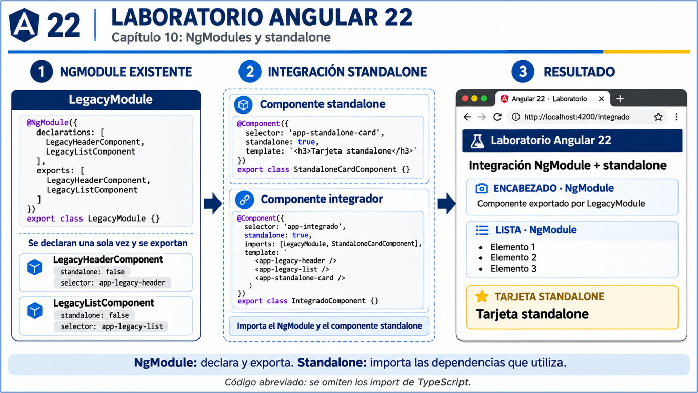

# Práctica 10.1  Manejo de módulos
<!--  -->

<br/>

## Objetivo

Construir una aplicación Angular 22 que integre componentes no standalone, declarados y exportados por un NgModule, con un componente standalone. Al finalizar, identificarás la función de `declarations`, `exports` e `imports` y comprobarás cómo reutilizar los componentes del módulo sin duplicar sus declaraciones.

<br/>

## Escenario

Un proyecto contiene un encabezado y una lista organizados mediante `LegacyModule`. Debes reutilizarlos en una página standalone y agregar una tarjeta standalone. El resultado se mostrará en `http://localhost:4200/integrado`, como en el diagrama del capítulo.

En esta práctica, **legacy** identifica código organizado mediante NgModule; no significa que NgModule haya dejado de funcionar. Se crea un módulo pequeño para simular la integración con una aplicación existente. La aplicación conserva su arranque standalone.



> La imagen se incluye en el paquete ZIP que acompaña este README. Todos los pasos y el código están completos en este documento y pueden seguirse sin la imagen.

<br/>

## Requisitos

| Herramienta | Requisito o uso | Comprobación |
|---|---|---|
| Node.js | Rama 22, versión 22.22.3 o posterior dentro de esa rama; también es compatible la rama 24 desde 24.15.0 | `node --version` |
| npm y npx | Incluidos con Node.js | `npm --version` y `npx --version` |
| Angular CLI | Versión principal 22; se utilizará mediante npx | `npx ng version`, dentro del proyecto |
| Visual Studio Code | Editor con Angular Language Service | `code --version` |
| Chrome o Edge | Visualización del resultado | Abrir el navegador |

Se requiere acceso a Internet para descargar los paquetes. No es necesario instalar otra copia global del CLI. Consulta la tabla oficial de compatibilidad al preparar el entorno: https://angular.dev/reference/versions.

<br/>
<br/>

## Instrucciones

### Paso 1. Crear el proyecto

Abre PowerShell en tu carpeta de laboratorios. Por ejemplo:

```powershell
New-Item -ItemType Directory -Force -Path "$HOME/angular-labs" | Out-Null
Set-Location "$HOME/angular-labs"
npx --yes --package @angular/cli@22 ng new laboratorio-modulos --routing --style=css --standalone --skip-git --skip-tests --file-name-style-guide=2016 --ssr=false --ai-config=none --defaults --interactive=false
Set-Location laboratorio-modulos
code .
npx ng version
```

Comprueba que Angular y Angular CLI pertenezcan a la versión principal **22**. El comando crea una aplicación con rutas, CSS y nombres como `app.component.ts`; deshabilita SSR y la creación de archivos de pruebas. Ejecuta el resto de los comandos desde la carpeta `laboratorio-modulos`.

> Si ya existe una carpeta con ese nombre, utiliza una carpeta de trabajo vacía para esta práctica.

<br/>
<br/>

### Paso 2. Generar el módulo y los componentes

Ejecuta los comandos en este orden:

```powershell
npx ng generate module legacy
npx ng generate component legacy/legacy-header --standalone=false --module=legacy/legacy.module --export --type=component --add-type-to-class-name=true --selector=app-legacy-header --skip-tests
npx ng generate component legacy/legacy-list --standalone=false --module=legacy/legacy.module --export --type=component --add-type-to-class-name=true --selector=app-legacy-list --skip-tests
npx ng generate component components/standalone-card --standalone --type=component --add-type-to-class-name=true --selector=app-standalone-card --skip-tests
npx ng generate component pages/integrado --standalone --type=component --add-type-to-class-name=true --selector=app-integrado --skip-tests
```

<br/>


| Opción | Propósito |
|---|---|
| `--standalone=false` | Permite declarar el componente en un NgModule. |
| `--module=legacy/legacy.module` | Indica el módulo propietario. |
| `--export` | Agrega el componente a los `exports` de ese módulo. |
| `--standalone` | Genera un componente que administra sus dependencias mediante `imports`. |
| `--type=component` | Conserva la extensión `.component.ts`. |
| `--add-type-to-class-name=true` | Conserva nombres de clase como `LegacyHeaderComponent`. |

Los archivos CSS generados pueden permanecer vacíos. En esta práctica se utilizará `src/styles.css` para compartir los estilos visuales. Reemplaza el contenido completo de cada archivo indicado a continuación; no agregues una segunda clase ni un segundo decorador.

<br/>
<br/>

### Paso 3. Implementar los componentes no standalone

### 3.1 Encabezado

**Archivo: `src/app/legacy/legacy-header/legacy-header.component.ts`**

```typescript
import { Component } from '@angular/core';

@Component({
  selector: 'app-legacy-header',
  standalone: false,
  templateUrl: './legacy-header.component.html'
})
export class LegacyHeaderComponent {}
```

**Archivo: `src/app/legacy/legacy-header/legacy-header.component.html`**

```html
<section class="tarjeta" aria-labelledby="titulo-encabezado">
  <h2 id="titulo-encabezado">ENCABEZADO · NgModule</h2>
  <p>Componente exportado por LegacyModule</p>
</section>
```

<br/>

### 3.2 Lista

**Archivo: `src/app/legacy/legacy-list/legacy-list.component.ts`**

```typescript
import { Component } from '@angular/core';

@Component({
  selector: 'app-legacy-list',
  standalone: false,
  templateUrl: './legacy-list.component.html'
})
export class LegacyListComponent {
  elementos: string[] = ['Elemento 1', 'Elemento 2', 'Elemento 3'];
}
```

**Archivo: `src/app/legacy/legacy-list/legacy-list.component.html`**

```html
<section class="tarjeta" aria-labelledby="titulo-lista">
  <h2 id="titulo-lista">LISTA · NgModule</h2>
  <ul>
    @for (elemento of elementos; track elemento) {
      <li>{{ elemento }}</li>
    }
  </ul>
</section>
```

**Observa:** ambos componentes tienen `standalone: false`. La lista usa el bloque `@for`, que forma parte del lenguaje de plantillas y no requiere importar `CommonModule`. Los textos son únicos en este ejemplo, por lo que pueden utilizarse en `track elemento`.

<br/>
<br/>

### Paso 4. Declarar y exportar desde LegacyModule

Los comandos ya agregaron los componentes al módulo. Comprueba el archivo y déjalo con este contenido:

**Archivo: `src/app/legacy/legacy.module.ts`**

```typescript
import { NgModule } from '@angular/core';
import { LegacyHeaderComponent } from './legacy-header/legacy-header.component';
import { LegacyListComponent } from './legacy-list/legacy-list.component';

@NgModule({
  declarations: [LegacyHeaderComponent, LegacyListComponent],
  exports: [LegacyHeaderComponent, LegacyListComponent]
})
export class LegacyModule {}
```

<br/>

| Propiedad | Función en la práctica |
|---|---|
| `declarations` | Establece que el encabezado y la lista pertenecen a `LegacyModule`. |
| `exports` | Permite utilizarlos en las plantillas de consumidores que importen el módulo. |

<br/>

**Regla:** cada componente no standalone se declara en un solo NgModule. Para reutilizarlo, se importa su módulo propietario. No se vuelve a declarar el componente.

Este módulo no necesita `CommonModule`: sus plantillas solo utilizan HTML, interpolación y `@for`. Tampoco requiere `BrowserModule` ni proveedores de servicios para este ejercicio.

<br/>
<br/>

### Paso 5. Implementar la tarjeta standalone

**Archivo: `src/app/components/standalone-card/standalone-card.component.ts`**

```typescript
import { Component } from '@angular/core';

@Component({
  selector: 'app-standalone-card',
  standalone: true,
  templateUrl: './standalone-card.component.html'
})
export class StandaloneCardComponent {}
```

**Archivo: `src/app/components/standalone-card/standalone-card.component.html`**

```html
<section class="tarjeta tarjeta-standalone" aria-labelledby="titulo-standalone">
  <h2 id="titulo-standalone">TARJETA STANDALONE</h2>
  <h3>Tarjeta standalone</h3>
  <p>Este componente se importa directamente en IntegradoComponent.</p>
</section>
```

Esta tarjeta se importa directamente donde se utiliza. No se agrega a los `declarations` de `LegacyModule`.

<br/>
<br/>

### Paso 6. Integrar los dos enfoques en una página

**Archivo: `src/app/pages/integrado/integrado.component.ts`**

```typescript
import { Component } from '@angular/core';
import { LegacyModule } from '../../legacy/legacy.module';
import { StandaloneCardComponent } from '../../components/standalone-card/standalone-card.component';

@Component({
  selector: 'app-integrado',
  standalone: true,
  imports: [LegacyModule, StandaloneCardComponent],
  templateUrl: './integrado.component.html'
})
export class IntegradoComponent {}
```

<br/>


**Archivo: `src/app/pages/integrado/integrado.component.html`**

```html
<main class="contenido">
  <h1>Integración NgModule + standalone</h1>
  <p class="introduccion">Dos componentes de un NgModule y un componente standalone en una misma vista.</p>

  <app-legacy-header />
  <app-legacy-list />
  <app-standalone-card />
</main>
```

En `imports`, **`LegacyModule`** hace accesibles sus componentes exportados; **`StandaloneCardComponent`** se importa directamente por ser standalone. Los `import` de TypeScript resuelven los símbolos del archivo; el arreglo `imports` de `@Component` establece las dependencias disponibles para su plantilla. Ambos cumplen funciones distintas.

<br/>
<br/>

### Paso 7. Configurar la navegación y el arranque

### 7.1 Rutas

**Archivo: `src/app/app.routes.ts`**

```typescript
import { Routes } from '@angular/router';
import { IntegradoComponent } from './pages/integrado/integrado.component';

export const routes: Routes = [
  { path: '', redirectTo: 'integrado', pathMatch: 'full' },
  { path: 'integrado', component: IntegradoComponent },
  { path: '**', redirectTo: 'integrado' }
];
```

La ruta vacía redirige a `/integrado`. `pathMatch: 'full'` limita esa redirección a la URL inicial. La ruta comodín se deja al final.

<br/>

### 7.2 Configuración de la aplicación

**Archivo: `src/app/app.config.ts`**

```typescript
import { ApplicationConfig } from '@angular/core';
import { provideRouter } from '@angular/router';
import { routes } from './app.routes';

export const appConfig: ApplicationConfig = {
  providers: [provideRouter(routes)]
};
```

<br/>

### 7.3 Componente raíz

**Archivo: `src/app/app.component.ts`**

```typescript
import { Component } from '@angular/core';
import { RouterOutlet } from '@angular/router';

@Component({
  selector: 'app-root',
  standalone: true,
  imports: [RouterOutlet],
  templateUrl: './app.component.html'
})
export class AppComponent {}
```

<br/>

**Archivo: `src/app/app.component.html`**

```html
<header class="cabecera-app">
  <span class="marca">A22</span>
  <strong>Laboratorio Angular 22</strong>
</header>

<router-outlet />

<footer class="pie-app">
  Práctica 10.1 · Manejo de módulos
</footer>
```

`RouterOutlet` indica dónde se presenta la página asociada a la ruta. El componente raíz importa el outlet; `IntegradoComponent` importa las dependencias de su propia plantilla.

<br/>

### 7.4 Punto de entrada

Reemplaza también `src/main.ts` para mantener congruencia con el nombre `AppComponent` y evitar una referencia anterior a una clase llamada `App`.

**Archivo: `src/main.ts`**

```typescript
import { bootstrapApplication } from '@angular/platform-browser';
import { AppComponent } from './app/app.component';
import { appConfig } from './app/app.config';

bootstrapApplication(AppComponent, appConfig)
  .catch((error) => console.error(error));
```

La aplicación arranca con `bootstrapApplication`. `LegacyModule` se utiliza como dependencia de la página; no se crea un `AppModule`.

<br/>
<br/>

### Paso 8. Aplicar los estilos

**Archivo: `src/styles.css`**

```css
* { box-sizing: border-box; }

body {
  margin: 0;
  background: #f4f7fb;
  color: #172b4d;
  font-family: Arial, Helvetica, sans-serif;
  line-height: 1.5;
}

.cabecera-app {
  display: flex;
  align-items: center;
  gap: 14px;
  padding: 20px max(24px, calc((100% - 900px) / 2));
  color: white;
  background: #062c62;
  border-bottom: 4px solid #f5be00;
  font-size: 1.3rem;
}

.marca {
  padding: 3px 8px;
  border: 1px solid #9fc3f2;
  border-radius: 8px;
  font-weight: bold;
}

.contenido {
  max-width: 948px;
  margin: 32px auto;
  padding: 0 24px;
}

h1 { color: #062c62; font-size: clamp(1.5rem, 4vw, 2rem); }
.introduccion { color: #526580; margin-bottom: 24px; }

app-legacy-header, app-legacy-list, app-standalone-card { display: block; }

.tarjeta {
  margin-bottom: 20px;
  padding: 20px 24px;
  background: white;
  border: 1px solid #b9cfee;
  border-left: 5px solid #1565c0;
  border-radius: 10px;
  box-shadow: 0 3px 12px #062c6208;
}

.tarjeta h2 { margin: 0 0 12px; color: #1454a0; font-size: 1rem; }
.tarjeta h3 { margin: 0 0 8px; font-size: 1.4rem; }
.tarjeta p, .tarjeta ul { margin: 0; }
.tarjeta ul { padding-left: 24px; }
.tarjeta-standalone { background: #fffbed; border-color: #e8bd42; }
.tarjeta-standalone h2 { color: #866000; }
.pie-app { padding: 16px 24px 32px; color: #526580; text-align: center; }
```

Opcionalmente, cambia el texto de `<title>` en `src/index.html` a `Angular 22 · Laboratorio`, conservando las demás etiquetas del archivo.

<br/>
<br/>


### Paso 9. Compilar y comprobar el resultado

Primero verifica la compilación:

```powershell
npx ng build
```

Debe terminar sin errores. A continuación, inicia el servidor:

```powershell
npx ng serve --open
```

Mantén esa terminal activa. Abre **http://localhost:4200/integrado**. La dirección inicial `http://localhost:4200/` también debe redirigir a `/integrado`.

<br/>

### Resultado esperado

| Elemento visible | Contenido | Origen |
|---|---|---|
| Barra superior | Laboratorio Angular 22 | Componente raíz |
| Título principal | Integración NgModule + standalone | `IntegradoComponent` |
| Encabezado | ENCABEZADO · NgModule; Componente exportado por LegacyModule | `LegacyHeaderComponent`, exportado por `LegacyModule` |
| Lista | LISTA · NgModule; Elemento 1, Elemento 2 y Elemento 3 | `LegacyListComponent`, exportado por `LegacyModule` |
| Tarjeta amarilla | TARJETA STANDALONE; Tarjeta standalone | `StandaloneCardComponent`, importado directamente |

Las tres tarjetas deben mostrarse en una misma página y no deben aparecer errores de componentes desconocidos en la terminal. La apariencia mantiene el fondo claro, los acentos azules y la tarjeta amarilla del diagrama.

<br/>
<br/>

### Paso 10. Comprobar la función de exports

Realiza un cambio temporal y restáuralo al finalizar:

1. Deja activo `ng serve` y abre `src/app/legacy/legacy.module.ts`.
2. Retira **únicamente** `LegacyListComponent` del arreglo `exports`. Consérvalo en el `import` de TypeScript y en `declarations`.
3. Guarda y revisa la terminal. Debe aparecer un error indicando que `app-legacy-list` no es un elemento conocido en la plantilla de `IntegradoComponent`.
4. Explica por qué pertenecer a `declarations` no basta para utilizarlo desde otro consumidor.
5. Agrega nuevamente `LegacyListComponent` a `exports` y guarda.
6. Confirma que la compilación se recupera y vuelve a mostrarse la lista.

La redacción exacta del diagnóstico puede variar entre versiones del compilador. No agregues `CUSTOM_ELEMENTS_SCHEMA` para ocultar el problema: la corrección consiste en restablecer la exportación.

<br/>
<br/>

## Conceptos repasados

| Concepto | Aplicación |
|---|---|
| `@NgModule` | Define el módulo propietario de los dos componentes no standalone. |
| `declarations` | Registra la pertenencia de esos componentes. |
| `exports` | Publica los componentes para los consumidores del módulo. |
| `standalone: false` | Permite declarar el componente en un NgModule. |
| `standalone: true` | Permite importar directamente un componente como dependencia de plantilla. |
| `imports` de `@Component` | Integra el módulo y la tarjeta en la página standalone. |
| `@for` | Repite los elementos sin depender de `CommonModule`. |
| `provideRouter` y `RouterOutlet` | Configuran las rutas y presentan la página. |
| `bootstrapApplication` | Arranca la aplicación con un componente raíz standalone. |

<br/>

`providers` se estudia en el capítulo, pero esta práctica solo necesita `provideRouter(routes)` para configurar la navegación; no implementa servicios propios.

<br/>
<br/>

## Preguntas de reflexión

1. ¿Por qué los componentes del encabezado y la lista tienen `standalone: false`?
2. ¿Qué diferencia existe entre `declarations` y `exports`?
3. ¿Por qué `IntegradoComponent` importa `LegacyModule` en lugar de importar directamente sus dos componentes no standalone?
4. ¿Por qué `StandaloneCardComponent` puede importarse directamente?
5. ¿Qué impide utilizar la lista desde la página cuando se retira de `exports`?


<br/>
<br/>


### Lista de verificación

- [ ] Angular y Angular CLI pertenecen a la versión principal 22.
- [ ] Los dos componentes no standalone se declaran únicamente en `LegacyModule`.
- [ ] El módulo exporta ambos componentes.
- [ ] La tarjeta standalone se importa directamente en el integrador.
- [ ] La navegación muestra `/integrado` y las tres tarjetas.
- [ ] Se realizó y revirtió la comprobación de `exports`.
- [ ] `npx ng build` termina sin errores.

<br/>
<br/>

## Solución de problemas

| Situación | Revisión o solución |
|---|---|
| No se encuentra `app.routes.ts` | Crea el archivo en `src/app` con el contenido del paso 7.1 y verifica `import { routes } from './app.routes'`. |
| No existe la exportación `App` o `AppComponent` | Sustituye conjuntamente `app.component.ts` y `main.ts` por los bloques del paso 7. |
| El CLI no encuentra el NgModule al generar un componente | Crea primero `LegacyModule` y ejecuta el comando desde la raíz del proyecto con `--module=legacy/legacy.module`. |
| Un componente standalone no puede declararse en un NgModule | Verifica `standalone: false` en los dos componentes legacy; retira cualquier componente standalone de `declarations`. |
| `app-legacy-header` o `app-legacy-list` no es conocido | Comprueba sus selectores, los `exports` de `LegacyModule` y el `imports: [LegacyModule, ...]` del integrador. |
| `app-standalone-card` no es conocido | Agrega `StandaloneCardComponent` al `imports` de `IntegradoComponent`. |
| Un componente se declara en más de un NgModule | Conserva su declaración solo en el módulo propietario y reutilízalo mediante la importación de ese módulo. |
| Sigue apareciendo la plantilla inicial de Angular | Reemplaza `app.component.html` y verifica que contiene `<router-outlet />`. |
| PowerShell bloquea `npx.ps1` | Usa `npx.cmd` en lugar de `npx` en los comandos, sin modificar la política del equipo. |
| El puerto 4200 está ocupado | Detén el otro servidor con Ctrl+C o usa `npx ng serve --port 4201 --open` y abre `/integrado` en ese puerto. |


<br/>
<br/>

## Referencias

- **NgModules:** declaraciones, importaciones, exportaciones e interoperabilidad con standalone.  
  https://angular.dev/guide/ngmodules/overview

- **Angular CLI: creación de proyectos:** opciones de `ng new`.  
  https://angular.dev/cli/new

- **Angular CLI: generación de componentes:** opciones de componentes standalone y no standalone.  
  https://angular.dev/cli/generate/component

- **Rutas:** definición de rutas y configuración de la navegación.  
  https://angular.dev/guide/routing/define-routes

- **Compatibilidad de versiones:** requisitos de Node.js, TypeScript y RxJS.  
  https://angular.dev/reference/versions

<!--  -->
